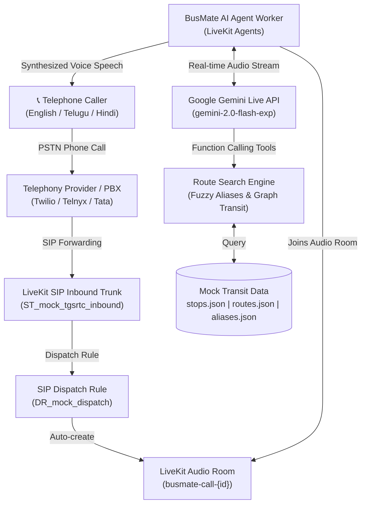

# BusMate AI — Multilingual Voice-Based Bus Route Assistant

> **Hyderabad City Bus Voice Information Assistant (TGSRTC Mock Prototype)**  
> Built with **Gemini Live**, **LiveKit Agents**, **LiveKit SIP**, and **FastAPI**.

---

## ⚠️ Important Disclaimer on Mock Data

**All transit route numbers (e.g., `DEMO-101`), schedules, fares, and stop arrival times in this prototype are synthetic demonstration data created for testing BusMate AI.**  
Never present fictional routes or timings as verified official TGSRTC information. In production, this layer connects directly to official TGSRTC GTFS-Realtime feeds or municipal transit APIs.

---

## 1. System Overview

BusMate AI is an inbound telephone-based voice assistant designed for Hyderabad commuters. A user dials a local phone number (`+91-40-MOCKBUS`) and asks natural questions such as:

- *"Which bus should I take from Tukkuguda to Mehdipatnam?"*
- *"తుక్కుగూడ నుంచి మెహదీపట్నం ఎలా వెళ్లాలి?"*
- *"मुझे तुक्कुगुड़ा से मेहदीपट्टनम जाना है।"*
- *"Is there a direct bus?"*
- *"Where should I board and alight?"*
- *"Do I need to change buses?"*
- *"What is the estimated fare and next departure time?"*



---

## 2. Multilingual Voice Support

BusMate AI supports three primary languages with real-time detection, dynamic switching, and code-mixing acceptance:

1. **English (Indian English)**
2. **Telugu (తెలుగు)**
3. **Hindi (हिंदी)**

### Key Multilingual Features
- **Opening Greeting:** Starts politely in welcoming English and Telugu:  
  *"Namaskaram! Welcome to BusMate AI, your Hyderabad bus information assistant. You can speak in Telugu, English, or Hindi. Where would you like to travel from and to?"*
- **Automatic Language Detection:** Inspects spoken utterances and responds in the caller's chosen language.
- **Mid-Conversation Switching:** The caller can switch at any time (e.g. from English to *"Telugu lo cheppandi"* or *"Hindi mein bataiye"*).
- **Code-Mixing (Tenglish / Hinglish):** Accurately understands English transit terms inside Telugu or Hindi sentences (*"Tukkuguda nunchi Mehdipatnam ki direct bus undha?"* or *"Mehdipatnam ke liye direct bus kab aayegi?"*).
- **Hyderabad Phonetic Aliases:** Recognizes local place names and colloquial variants (e.g., *Imlibun* for *MGBS*, *Rathifile* for *Secunderabad Station*, *Cyber Towers* for *Hitec City*, *Pillar 300* for *Aramghar*).
- **Telephone-Friendly Conciseness:** Keeps voice replies concise (2 to 3 sentences) to avoid overwhelming callers.

---

## 3. Mock Transit Dataset

Located in `data/`:
- [`data/stops.json`](file:///d:/BRAHMANI/GSSOC/voice%20agent/data/stops.json): Hyderabad stops including Tukkuguda, Mehdipatnam, LB Nagar, Aramghar, Secunderabad Station, Koti, Hitec City, Charminar, Gachibowli, MGBS, Lakdikapul, Uppal, and Shamshabad.
- [`data/routes.json`](file:///d:/BRAHMANI/GSSOC/voice%20agent/data/routes.json): Forward and return demonstration routes (e.g., `DEMO-101`, `DEMO-202`, `DEMO-303`, `DEMO-505`, `DEMO-606`, etc.) with schedules, frequencies, and fares.
- [`data/aliases.json`](file:///d:/BRAHMANI/GSSOC/voice%20agent/data/aliases.json): Multilingual aliases in English, Telugu, Hindi, and common phonetic transliterations.

---

## 4. Route Search Engine

The core engine in [`src/search_engine.py`](file:///d:/BRAHMANI/GSSOC/voice%20agent/src/search_engine.py) provides:

- `find_routes(source, destination)`:
  - Resolves stops case-insensitively and fuzzy-matches aliases.
  - Returns direct bus journeys (e.g., `DEMO-101` from Tukkuguda to Mehdipatnam).
  - Finds 1-transfer connecting journeys when direct routes do not exist (e.g., Tukkuguda to Secunderabad Station via Mehdipatnam or Lakdikapul).
  - Returns localized natural speech summaries in English, Telugu, and Hindi.
- `get_route_details(route_id)`: Fetches route stops, timings, frequencies, and operating schedules.
- `search_stops(query, language)`: Returns stop candidates ranked by Levenshtein confidence score.
- `get_next_departures(route_id, stop_id, date_time)`: Computes the next scheduled bus arrival times.
- `estimate_fare(route_ids, source, destination)`: Computes journey fares with explicit mock data disclaimers.

---

## 5. Telephone & LiveKit SIP Integration

BusMate AI is built on the LiveKit SIP architecture for PSTN telephony:

1. **Inbound Trunk:** LiveKit SIP Inbound Trunk accepts phone calls on `+91-40-MOCKBUS`.
2. **Dispatch Rule:** Directs inbound phone calls into isolated audio rooms (`busmate-call-<id>`).
3. **Telephony Metadata:** Automatically parses caller phone number (`From`), trunk number (`To`), and SIP call IDs.
4. **Third-Party Telephony Forwarding (Twilio / Telnyx):**
   ```xml
   <Response>
       <Say voice="Polly.Aditi" language="en-IN">Connecting to BusMate AI.</Say>
       <Dial>
           <Sip>sip:busmate@sip.livekit.cloud</Sip>
       </Dial>
   </Response>
   ```

---

## 6. Project Structure

```
voice agent/
├── data/
│   ├── stops.json          # Hyderabad stop definitions & multilingual names
│   ├── routes.json         # Mock bus route numbers, schedules, fares
│   └── aliases.json        # Phonetic, Telugu, and Hindi stop aliases
├── src/
│   ├── __init__.py
│   ├── config.py           # Environment variables & constants
│   ├── models.py           # Pydantic data schemas
│   ├── search_engine.py    # Route planner, fuzzy stop resolver & departures
│   ├── agent.py            # LiveKit Agent & Gemini Live voice assistant
│   ├── telephony.py        # LiveKit SIP trunks & dispatch rule manager
│   ├── api.py              # FastAPI REST endpoints & simulation API
│   └── static/             # Web testing playground & interactive UI
│       ├── index.html
│       ├── styles.css
│       └── app.js
├── tests/
│   ├── test_search_engine.py # Unit tests for transit search engine
│   ├── test_agent_tools.py   # Agent function calling & language detection
│   └── test_api.py           # FastAPI endpoint integration tests
├── .env.example            # Sample configuration
├── requirements.txt        # Python package dependencies
└── README.md
```

---

## 7. Quickstart & Installation

### Step 1: Set Up Python Virtual Environment
```bash
python -m venv .venv
# On Windows:
.\.venv\Scripts\activate
# On Linux/macOS:
source .venv/bin/activate
```

### Step 2: Install Dependencies
```bash
pip install -r requirements.txt
```

### Step 3: Configure Environment Variables
Copy `.env.example` to `.env` and provide your API keys:
```bash
cp .env.example .env
```
Key variables:
- `GEMINI_API_KEY`: Your Google Gemini API key.
- `LIVEKIT_URL`: LiveKit Cloud WebSocket URL (`wss://...`).
- `LIVEKIT_API_KEY` & `LIVEKIT_API_SECRET`: LiveKit project credentials.

### Step 4: Run Test Suite
```bash
pytest -v
```

### Step 5: Start the Web Playground & REST API
```bash
uvicorn src.api:app --reload --port 8000
```
Open [http://localhost:8000](http://localhost:8000) in your browser to:
- Test voice conversations with the telephone simulator in English, Telugu, or Hindi.
- Search routes with stop-by-stop visual timelines.
- Inspect LiveKit SIP trunk configs.

### Step 6: Run Voice Agent in Standalone Simulation Mode
```bash
python -m src.agent --simulate
```
Interactive terminal prompt:
```text
=== BusMate AI Interactive Voice Simulation Console ===
Namaskaram! Welcome to BusMate AI, your Hyderabad bus information assistant. You can speak in Telugu, English, or Hindi. Where would you like to travel from and to?

Caller: Which bus should I take from Tukkuguda to Mehdipatnam?
BusMate AI (en): You can take direct bus DEMO-101 (City Ordinary (MOCK)) from Tukkuguda to Mehdipatnam. The journey takes approximately 50 minutes with a fare of 35 rupees. (Demo schedule)

Caller: తుక్కుగూడ నుంచి మెహదీపట్నం ఎలా వెళ్లాలి?
BusMate AI (te): తుక్కుగూడ నుంచి మెహదీపట్నం కు డైరెక్ట్ బస్సు DEMO-101 ఉంది. ప్రయాణ సమయం సుమారు 50 నిమిషాలు, ఛార్జీ 35 రూపాయలు.

Caller: mujhe tukuguda se mehdipatnam jana hai
BusMate AI (hi): तुक्कुगुड़ा से मेहदीपट्टनम के लिए सीधी बस DEMO-101 उपलब्ध है। सफ़र में लगभग 50 मिनट लगेंगे और किराया 35 रुपये है।
```

### Step 7: Launch LiveKit Real-Time Agent Worker
```bash
python -m src.agent dev
```
Listens for live SIP calls or WebRTC audio participants entering LiveKit rooms.
